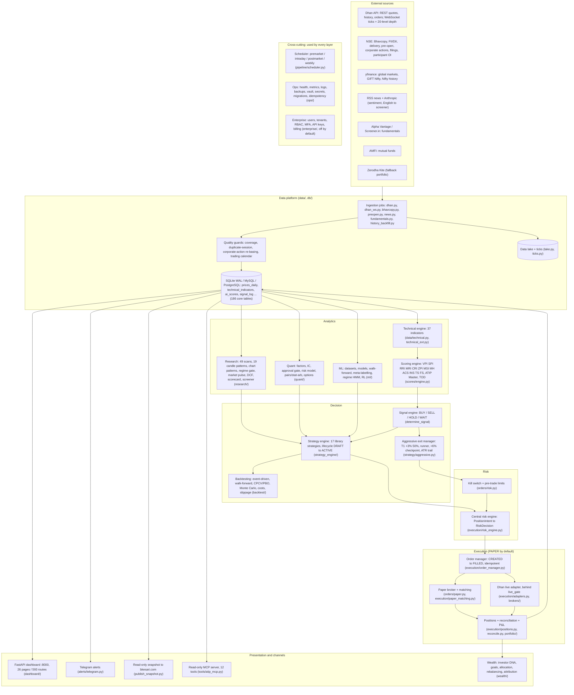
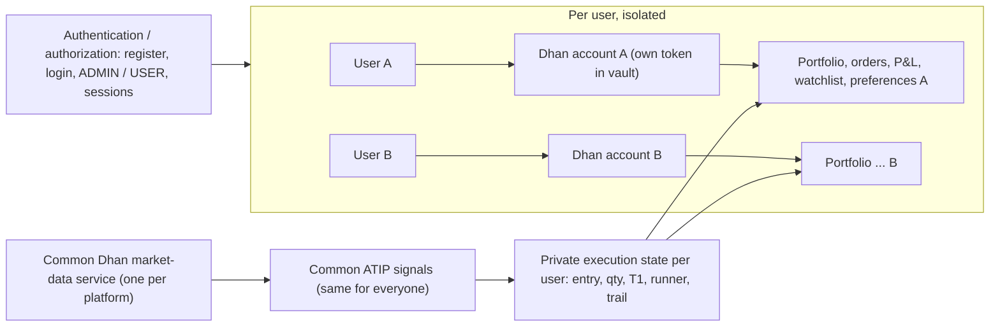
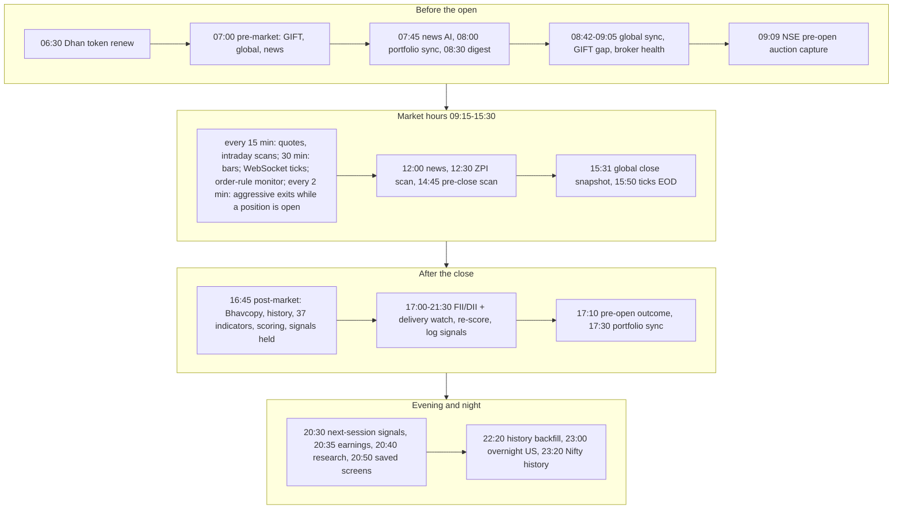
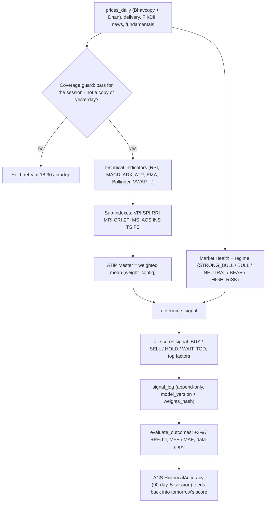
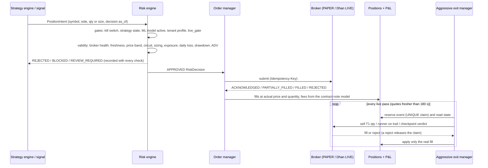
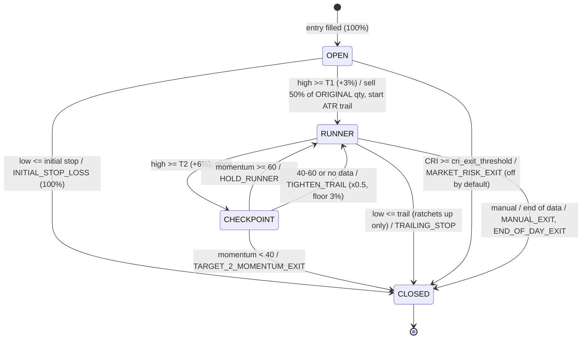
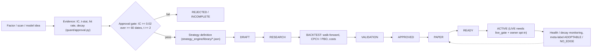

# ATIP master file: architecture, process flows, terminology, features and the 4% / 75% objective

*Written 2026-10-26 from branch `claude/youthful-archimedes-mubyk3` at `bed2562` (ATIP-DEV = ATIP). Every figure is
read from the code, the repository's own docs, or the simulations in §7, which are reproducible with
`tools/master_file.py`. The full feature list (333 tracked features plus the new requirements) is in the
workbook next to this file: `ATIP_MASTER_FILE_2026-10-26.xlsx`. Updated the same day with the owner's decisions:
the MRI fix (finding 1), the scheduled exit manager (finding 3) and single-owner ATIP (§6.1).*

Contents

1. [Executive summary](#1-executive-summary)
2. [Architecture](#2-architecture)
3. [Process flows](#3-process-flows)
4. [Terminology](#4-terminology)
5. [Feature catalogue](#5-feature-catalogue)
6. [Review of the consolidated development prompt against the code](#6-review-of-the-consolidated-development-prompt-against-the-code)
7. [The objective: 4% profit per trade at a 75%+ success ratio](#7-the-objective-4-profit-per-trade-at-a-75-success-ratio)
8. [Roadmap](#8-roadmap)
9. [Sources](#9-sources)

---

## 1. Executive summary

**What ATIP is.** A personal NSE/BSE trading-intelligence platform in Python 3.11+: Dhan market data and
broker, a nightly scoring engine (ATIP Master score and 12 sub-indexes), 49 technical scans, research,
quant, ML, a strategy engine with a lifecycle, a central risk gateway, paper-first execution, portfolio and
wealth modules, a FastAPI dashboard (593 API routes, 26 HTML pages), Telegram alerts and a read-only snapshot
published to bkesari.com. The code is 480 Python files and about 131,000 lines, with 1,315 test functions.
The owner's tracker lists 333 features. 126 are COMPLETED, 197 are IMPLEMENTED BUT NOT VERIFIED, 9 are
BLOCKED and 1 is IN PROGRESS.

**The objective, stated plainly.** No configuration of ATIP, and no exit rule on its own, can be expected to
deliver **+4% per trade at a 75% or better success ratio**. The geometry rules it out (§7.2):

- With no edge, the chance of reaching +4% before a stop of S% is about S / (4 + S). A 75% hit rate
  therefore "comes free" only with a 12% stop. At that stop the expectancy is negative after costs.
- Reaching 75% with a 3–4% stop needs the chosen stocks to rise, during the hold, at a pace equal to
  roughly **120% to 300% or more a year** (§7.3). That is not a credible steady-state edge.
- An **average** profit of 4% per trade is not possible with a +4% target at all. The most a +4% target can
  pay is 3.75% net, and only if every trade wins.
- ATIP's own measured evidence is far from this. The hit rate at +3% is 46.6% (27 of 58 signals watched),
  where it once showed 95.2%. The signal model ran at a 47.5% win rate with a profit factor of 0.90. A
  flat 3% target was negative after costs on real bars, and the aggressive policy made +0.12% per trade
  (§7.4).

**What is achievable, and how ATIP gets there.** With a genuine edge (selected stocks drifting up 20–40% a
year), the best exit geometry tested gives a **62–71% win rate and +0.1% to +1.3% net per trade**. The
geometry is a +4% first target that books 70%, a wider initial stop (6% in the test, about 2–2.5× ATR) and
a trailing runner. That range is the realistic target band. The lever is **entry selection**, not the
exit. ATIP already has the tools to raise selection quality:

- the market regime gate and Market Health;
- confluence, ACS and delivery accumulation;
- meta-labelling with triple-barrier labels and an adoption gate;
- walk-forward, CPCV and PBO validation.

What is missing is wiring these together for one +4% profile and proving it on real history and in paper
trading (§7.6–7.8, roadmap §8).

**Findings for the owner** (details in §6):

1. **Fixed (owner-approved, 2026-10-26): MRI was read the wrong way round at the +6% runner checkpoint.**
   The score engine scores MRI so that higher is more bullish (`scores/engine.py:470-487`), and the signal
   engine sells on *low* MRI (`scores/engine.py:807`). But `Momentum.composite` inverted MRI as a risk
   measure, so strong momentum pushed a runner toward exit and weak momentum toward holding. MRI now
   enters as it is (`strategy/aggressive.py:198-199`). The test fixtures are mirrored, so every existing
   result is unchanged, and `test_mri_counts_as_strength_the_way_the_score_engine_reads_it` pins the
   direction against `determine_signal`.
2. **Index names disagree across documents.** The code defines VPI as Volatility-Potential and SPI as
   Stability Profit. The strategy library and the formulas workbook call them "value/profit" and
   "stock/sector strength". §4 fixes the canonical meanings from the code.
3. The consolidated prompt's aggressive-strategy logic (phases 4, 6, 8, 13) is **already built and
   tested**. Nothing scheduled it: exits ran only when `python -m strategy.live --manage` was run by hand.
   **Scheduled (owner-approved, 2026-10-26):** a management pass now runs every `manage_interval_minutes`
   (default 2) from 09:15 to 15:30 on trading days while a position is open. Unattended, it never sells a
   position through a broker other than the one it was opened with (PAPER vs LIVE). **Decided 2026-10-26:
   ATIP stays single-owner**, in line with PR #11's owner-only gate, so the prompt's multi-user phases
   (3, 5 and the per-user parts of 7 and 9) are not planned. See §6.
4. **Fixed: the owner's dashboard token reached other tenants (R12).** Measured 2026-10-26: 18 pages gave another
   tenant's viewer the install-wide `X-ATIP-Token`, which guards the write routes. Now the install's token goes only
   to the owner's requests, and another tenant's pages carry a per-session token that the write guard accepts for
   its session alone. The owner-book read leak found in the same review is fixed too (`OWNER_BOOK`,
   `tests/test_enterprise_owner_book.py`). Enterprise mode is still off.

---

## 2. Architecture

### 2.1 Current system (as built)



### 2.2 Layers and packages

| Layer | Packages | Built in wave | Runs |
|---|---|---|---|
| Data platform | `data/`, `db/`, `utils/trading_calendar.py` | W1, W21, W27, W35, W39 | scheduler + WebSocket threads |
| Technical and scoring | `data/technical*.py`, `scores/` | W1, W22, W27 | 16:45 post-market, re-score by 21:30 |
| Research and signals | `research/`, `strategy/intraday_scan.py` | W39, W39b | 20:30 next-session signals; intraday every 15 min |
| Quant | `quant/`, `altdata/` | W6, W22, W30 | nightly / weekly |
| AI / ML | `ml/` | W5, W24, W36, W40 | off by default (`config.json` "ml") |
| Strategy | `strategy_engine/`, `strategy/` | W3, W28, W39b | decisions for PAPER / READY / ACTIVE strategies |
| Backtesting | `backtest/`, `scores/backtest.py`, `strategy/backtest_*.py` | W2, W23, W39b, W40 | on demand |
| Risk | `orders/risk.py`, `execution/risk_engine.py`, `portfolio/limits.py`, `ops/trading_safety.py` | W4, W25, W29, W39 | every order |
| Execution | `execution/`, `orders/`, `brokers/` | W4, W29, W34, W37 | PAPER default; LIVE behind `live_gate` |
| Portfolio and wealth | `portfolio/`, `wealth/` | W11–W20, W25 | 08:00 / 17:30 sync |
| Presentation | `dashboard/`, `alerts/`, `publish_snapshot.py`, `tools/atip_mcp.py` | W1, W26, W39 | dashboard thread on :8000 |
| Ops and enterprise | `ops/`, `enterprise/`, `deploy/`, `Dockerfile` | W7, W8, W31, W32, W38 | always on / off by default |

**Runtime.** `main.py` runs one process. It takes a single-instance lock, then starts `ops.startup`, then three
threads: the dashboard (uvicorn :8000), the index feed (Dhan WebSocket during market hours) and the scheduler
loop (15-second tick). It runs on the owner's Mac under a LaunchAgent with `TZ=Asia/Kolkata`. A container
image (`Dockerfile`, `docker-compose.yml`) is built and smoke-tested in CI but not deployed.

### 2.3 Target architecture from the consolidated prompt (multi-user)



**Not adopted.** The owner decided on 2026-10-26 that ATIP stays single-owner: one Dhan account, one
portfolio, behind the central owner-only gate of PR #11. The diagram is kept as a record of what the
consolidated prompt proposed; §6 sets out how much of it exists.

---

## 3. Process flows

### 3.1 The trading day (IST)



Weekly jobs:

- Saturday: fundamentals (08:00), the Dhan security master (08:30), the accuracy audit (09:00) and impact
  calibration (09:00).
- Sunday: the restore drill (10:00).

Catch-up runs at 18:30 and at startup, and covers the last 5 sessions, oldest first.

The aggressive exit manager runs every `manage_interval_minutes` (default 2) from 09:15 to 15:30 on trading
days, and only while a strategy position is open (`strategy/live.py` `schedule_jobs`, registered by
`pipeline/scheduler.py`). `python -m strategy.live --manage` still runs one pass by hand. See review row P4.

### 3.2 Data to signal



The signal rules (`scores/engine.py:789-808`) are evaluated in this order:

1. CRI > 75 → SELL if ATIP < 40, else HOLD.
2. Regime HIGH_RISK → WAIT.
3. Regime BEAR with ATIP < 70 → WAIT.
4. **BUY strict**: ATIP ≥ 75, VPI ≥ 70, ZPI ≥ 65, ACS ≥ 60 and MH ≥ 50.
5. **BUY loose**: ATIP ≥ 65, VPI ≥ 60, ZPI ≥ 55 and MH ≥ 40.
6. SELL if ATIP < 30, or if CRI > 60 and MRI < 40.
7. Otherwise HOLD if ATIP ≥ 50, else WAIT.

### 3.3 Signal to trade (paper first)



### 3.4 Aggressive exit state machine (`strategy/aggressive.py`, `strategy/positions.py`)



The trail distance is 4 × ATR%, clamped between 3% and 20%. A 1-share position cannot be split, so it rides
whole to the trail. `aggressive_enabled` is false by default and `execution_mode` is PAPER by default.

### 3.5 Research to production



---

## 4. Terminology

Canonical meanings are taken from the code. Where another document disagrees, the code wins, and the
disagreement is noted.

### 4.1 ATIP scores and indexes (0–100 unless stated)

| Term | Full name | Meaning in ATIP | Where |
|---|---|---|---|
| ATIP Master Score | ATIP Master | Weighted mean of VPI 0.20, SPI 0.15, RRI 0.10, MRI 0.10, MSI 0.10, ZPI 0.10, TS 0.10, FS 0.10, INS 0.05. Missing parts are left out and the weights renormalised | `scores/engine.py`, `weight_config` |
| VPI | Volatility-Potential Index | Room and fuel for a swing: ATR% 0.18, trend strength (ADX) 0.15, relative strength vs Nifty 0.12, liquidity 0.10, volume expansion 0.10, mean reversion 0.10, fundamental growth 0.10, institutional 0.08, news 0.07. *The strategy library calls it "value/profit": that is wrong* | `scores/engine.py` compute_vpi |
| SPI | Stability Profit Index | Fundamental quality: ROE 0.20, ROCE 0.15, EPS growth 0.15, revenue growth 0.10, FCF 0.10, debt/equity (inverse) 0.10, PEG (inverse) 0.10, quality 0.10. Scores only when `fundamentals.score_enabled`. *The formulas workbook calls it "stock/sector strength": that is wrong* | `scores/fundamental.py` |
| RRI | Recovery (Rebound) Index | Rebound from the 52-week low 0.25, near support 0.20, volume on up days 0.15, RSI crossing 30 0.15, DII/MF buying 0.15, positive news 0.10 | `compute_rri` |
| MRI | Momentum-Reversal Index | Bullish momentum turn: MACD (price-normalised) 0.25, RSI zone 0.20, ADX falling (inverse) 0.15, volume surge 0.15, EMA 9 > 21 0.15, catalyst news 0.10. **Higher = more bullish** (the signal engine sells on MRI < 40) | `compute_mri` |
| CRI | Crash-Risk Index | **Higher = riskier**: high ATR near the 52-week high, high D/E, distribution (volume on down days), below DMAs, negative news, market weakness. CRI > 75 is "danger" | `compute_cri` |
| ZPI | Buy-Zone Index | Is the price in a buy zone: near support, room to resistance, RSI 30–50, ATR R:R ≥ 1:3, low-volume pullback, above the 200-DMA, delivery accumulation (10 vs 60 sessions), no negative news, top-3 sector. ZPI ≥ 75 = "Buy Zone" panel | `compute_zpi` |
| MSI | Market Sentiment Index | Market-wide sentiment: aggregate news 0.30, FII 5-day 0.20, DII 0.15, % sectors green 0.10, PCR (inverse) 0.10, global 0.10, VIX (inverse) 0.05 | `compute_msi` |
| MH | Market Health | Market regime score: Nifty trend 0.20, Bank Nifty 0.15, breadth (% above 200-DMA) 0.10, VIX (inverse) 0.10, FII 0.10, DII 0.10, global 0.10, sector breadth 0.10, A/D 0.05. Stored only with ≥ 50% of the weight present | `compute_mh` |
| Regime | MH regime | STRONG_BULL ≥ 80, BULL ≥ 60, NEUTRAL ≥ 40, BEAR ≥ 20, HIGH_RISK < 20 | `mh_regime` |
| ACS | AI Confidence Score | How far to trust today's call: historical accuracy (5-session hits over 90 days) 0.25, % of indexes agreeing 0.20, regime (MH > 60) 0.20, data quality 0.15, AI news confidence 0.10, liquidity 0.10 | `compute_acs` |
| INS | Institutional Score | FII 5-day 0.40, DII 0.30, promoter holding 0.20, bulk/block deals (10 days) 0.10; with W27, plus MF change, insider PIT and pledge | `compute_ins` |
| TS | Technical Score | RSI, MACD, ADX, ATR, EMA alignment, VWAP, Bollinger, volume, 200-DMA, S/R, gap, relative volume | `weight_config` "TS" |
| FS | Fundamental Score | Value / quality / balance-sheet composite (W27, SC-13) | `scores/fundamental.py` |
| TOD | Trade of the Day | VPI 0.20, ZPI 0.15, MRI 0.15, MSI 0.10, volume breakout 0.10, price breakout 0.10, sector 0.10, ACS 0.10; one per session, with CMP, SL, T1 and T2 | `scores/engine.py` |
| Portfolio Health Score | — | Health of the owner's holdings with the ATIP overlay | `scores/portfolio_health.py` |
| Formula registry / weights_hash | — | Every signal is stamped with the git commit and a hash of the active weights; the hash resolves back to the weights | `scores/formulas.py`, `scores/signal_log.py` |
| Score components | — | The sub-factor values behind every labelled score, stored per symbol and date | `score_components` |

### 4.2 Signals, scans and research

| Term | Meaning in ATIP | Where |
|---|---|---|
| BUY / SELL / HOLD / WAIT | The signal engine's verdicts (rules in §3.2) | `determine_signal` |
| BUY_STRICT / BUY_LOOSE | The two BUY threshold sets | `scores/engine.py:789-790` |
| Signal log | Append-only record of what ATIP said, never rewritten | `signal_log` |
| Signal outcome / hit rate | Whether price touched +3% / +6% after the signal, with MFE / MAE; the denominator is every signal watched for at least one session | `signal_outcome`, `success_report` |
| MFE / MAE | Maximum favourable / adverse excursion after entry | `signal_outcome` |
| Technical signal | A scan hit with entry, stop 2 × ATR, target 4 × ATR (+2 R), horizon 20 sessions (60 for events); closes TARGET / STOPPED / EXPIRED | `research/tech_signals.py` |
| Confluence (x/6) | How many independent confirmations a technical signal has | `research/tech_signals.py` |
| R multiple (R) | P&L in units of the initial risk (entry − stop); a target at 4 × ATR with a 2 × ATR stop = +2 R | `TS.r_multiple` |
| Scan | One of 49 rule-based setups (47 in `research/technicals.py` SCANS + 2 PEAD) (golden cross, Minervini trend template, VCP, Darvas, pocket pivot, RS-line new high, delivery spike, PEAD ...) | `research/technicals.py` |
| Market regime gate | O'Neil-style market direction from distribution and follow-through days and the 200-DMA: OPEN / CAUTION / CLOSED; signals are WITH / MIXED / AGAINST the market | `research/regime_gate.py` |
| Distribution day | Nifty down ≥ 0.2% on higher volume; active 25 sessions | `regime_gate.py` |
| Follow-through day | Day 4+ of a rally attempt with the Nifty up ≥ 1.25% on higher volume | `regime_gate.py` |
| RS rating / RS line | Relative strength vs Nifty, ranked; the RS line making a new high before price | `research/technicals.py` |
| Delivery % / accumulation | Share of traded volume taken to delivery; ZPI uses 10-session delivery vs the stock's 60-session average | `data/bhavcopy.py`, `compute_delivery_accumulation` |
| PEAD / SUE | Post-earnings announcement drift; standardised unexpected earnings | `research/earnings_surprise.py` |
| Scorecard | 5 axes × 6 pass / fail fundamental checks | `research/scorecard.py` |
| DVM | Durability / valuation / momentum ratings | `research/dvm.py` |
| Market pulse | Global-cue model, GIFT gap, FII flow pressure, participant OI, OI walls | `research/market_pulse.py` |
| GIFT Nifty gap | Expected opening gap from GIFT Nifty, basis-free | `research/market_pulse.py` |
| Pre-open / IEP | NSE pre-open auction (09:00–09:08) and its indicative equilibrium price | `data/preopen.py` |
| 75-minute rating (TF75) | Technical rating on 75-minute bars | `tests/test_w39b_tf75*.py` |

### 4.3 Trading, exits and risk

| Term | Meaning in ATIP | Where |
|---|---|---|
| Aggressive strategy | Book T1 partially, keep a runner on a trailing stop, treat T2 as a momentum checkpoint | `strategy/aggressive.py` |
| T1 / Target 1 | First profit target, default +3%; sells `target_1_exit_pct` (50%) of the ORIGINAL quantity | `DEFAULTS` |
| T2 / Target 2 | +6% momentum checkpoint, **not** an exit by itself | `checkpoint_decision` |
| Runner | The shares left after T1, managed by the trail | `ST_RUNNER` |
| Trailing stop (TSL) | High-water × (1 − trail%); trail% = 4 × ATR%, clamped to 3–20%; only ever ratchets toward price | `trail_distance_pct`, `ratchet` |
| HOLD_RUNNER / TIGHTEN_TRAIL / EXIT_RUNNER | The checkpoint verdicts at momentum ≥ 60 / 40–60 / < 40 | `checkpoint_decision` |
| Momentum composite | Mean of the available ZPI, MSI, MRI, CRI (inverse), MH, RSI, MACD sign and volume ratio (MRI was inverted until the 2026-10-26 fix, §6) | `Momentum.composite` |
| Exit reasons | INITIAL_STOP_LOSS, TARGET_1_PARTIAL_EXIT, TRAILING_STOP, TARGET_2_MOMENTUM_EXIT, MOMENTUM_REVERSAL, MARKET_RISK_EXIT, MANUAL_EXIT, END_OF_DAY_EXIT | `strategy/aggressive.py` |
| Claim / reserve → place → apply | Idempotent order pattern: a UNIQUE event claim, then the order, then only the real fill changes state | `strategy/live.py`, `strategy/positions.py` |
| Bracket / OCO | Entry + target leg + stop leg; one cancels the other | `orders/rules.py` |
| Rule (price alert / target) | A per-stock buy/sell trigger with stoploss and quantity that waits for confirmation unless opted out | `orders/rules.py` |
| PAPER / LIVE | Execution environments; PAPER is the default everywhere, and LIVE needs `execution.mode` LIVE and `live_trading_enabled` | `orders/environment.py`, `execution/config.py` |
| live_gate | The single check that a LIVE order may be sent | `execution/config.py` |
| Kill switch | `atip_data/TRADING_HALTED` or `trading_halted: true`; refuses confirmed orders in every environment | `orders/risk.py` |
| Pre-trade limits | max order value, orders/day, open positions, symbol exposure, daily loss, drawdown, ADV participation, price band (20%), circuit | `orders/risk.py`, `execution/risk_engine.py` |
| PositionIntent / RiskDecision | A strategy's request, and the risk engine's recorded verdict (APPROVED / REJECTED / BLOCKED / REVIEW_REQUIRED) | `execution/models.py` |
| Order states | CREATED → VALIDATED → SUBMITTED → ACKNOWLEDGED → PARTIALLY_FILLED / FILLED; CANCEL_PENDING → CANCELLED; REJECTED / FAILED | `execution/models.py` |
| Reconciliation | Matching ATIP's book to the broker's | `execution/reconcile.py` |
| Contract-note fees | Brokerage, STT, exchange, GST, stamp duty, SEBI fee per fill | `tests/test_w39_contract_note_fees.py` |
| Round-trip cost | Default 0.25% of turnover for backtests (brokerage + taxes + slippage) | `strategy/backtest_history.py` |
| Position sizing | Fixed-fraction / ATR risk sizing, capped by limits | `orders/risk.py` size_position |
| Basket / SIP | Basket orders and paper stock SIP plans | `orders/basket.py`, `orders/sip.py` |
| Option intents | Multi-leg option orders from option-overlay strategies, PAPER only | `execution/option_intents.py` |

### 4.4 Backtesting, validation and ML

| Term | Meaning in ATIP | Where |
|---|---|---|
| Win rate / success ratio | Share of trades with net P&L > 0 | `backtest_aggressive.metrics` |
| Expectancy | Mean net P&L per trade; `expectancy_pct` = as % of capital deployed | `metrics` |
| Profit factor (PF) | Gross profit ÷ gross loss (None when there are no losses) | `metrics` |
| Max drawdown | Deepest fall of the equity curve from its peak | `metrics`, `backtest/metrics.py` |
| CAGR / Sharpe / Sortino / Calmar | Annualised return and risk-adjusted ratios on a dated equity curve | `backtest/metrics.py` |
| Same-bar ambiguity | A daily bar touching both stop and target counts as the stop (pessimistic) | `backtest_aggressive.py`, `scores/backtest.py` |
| Walk-forward | Fit on a past window, test on the next, roll | `backtest/walkforward.py`, `ml/validation.py` |
| CPCV / PBO | Combinatorial purged cross-validation; probability of backtest overfitting | `backtest/cpcv.py` |
| Purge / embargo | Removing training labels that overlap a test fold, plus a gap after it | `ml/validation.py` |
| Monte Carlo | Resampling trades / paths to get a confidence band | `backtest/montecarlo.py` |
| Stochastic dominance | Comparing return distributions, not only means | `tests/test_w39b_cpcv_dominance.py` |
| Bayesian search | Parameter optimisation with a Bayesian search | `backtest/optimize.py` |
| IC (information coefficient) | Spearman correlation of a score with the forward return | `quant/research.py` |
| Factor approval gate | \|IC\| ≥ 0.02 over ≥ 60 dates, \|t\| ≥ 2, hit rate ≥ 52%, low correlation with approved factors | `quant/approval.py` |
| Triple-barrier label | 1 if the target is touched first, 0 if the stop is, or if neither is within the horizon | `ml/meta_label.py` |
| Meta-labelling | A secondary model estimating P(target first) for each primary signal; ADOPTABLE only with ≥ 200 OOS signals, ≥ 30 kept and ≥ 30 rejected, and t ≥ 2 | `ml/meta_label.py` |
| Bet size (AFML) | m = 2Φ(z) − 1, z = (p − 0.5)/√(p(1 − p)); reported only | `ml/meta_label.py` |
| Calibration | Whether a predicted 0.6 wins 60% of the time | `ml/validation.py` |
| Regime HMM | Hidden-Markov regime model | `ml/hmm.py` |
| Point in time | Every feature is read with data available at that date only | `docs/QUANT_ARCHITECTURE.md` |

### 4.5 Market and data terms (India)

| Term | Meaning in ATIP |
|---|---|
| NSE / BSE | National Stock Exchange / Bombay Stock Exchange |
| Bhavcopy | NSE's official end-of-day file (OHLC, volume, delivery), published at about 16:33 IST |
| CMP / LTP | Current market price / last traded price |
| OHLCV | Open, high, low, close, volume |
| ATR / ATR% | Average true range (14), and as % of price |
| RSI, MACD, ADX, EMA, SMA, VWAP, Bollinger, Supertrend, Donchian | Standard indicators (37 computed in `data/technical.py`) |
| DMA | Daily moving average (50-DMA, 200-DMA) |
| FII / DII | Foreign / domestic institutional investors; NSE publishes their net flows each evening |
| PCR | Put-call ratio (open interest) |
| OI | Open interest (futures and options); participant OI is by client category |
| India VIX | NSE volatility index |
| GIFT Nifty | Nifty futures on NSE IX (Gift City), used for the opening gap |
| Circuit limit | A stock's daily upper / lower price band |
| STT | Securities transaction tax |
| F&O | Futures and options |
| Security ID | Dhan's instrument identifier (from the security master) |
| Corporate action | Split, bonus or dividend; Dhan adjusts prices but not volume, and ATIP re-bases volume |
| AMFI | Association of Mutual Funds in India (MF data) |
| SEBI | Securities and Exchange Board of India |

### 4.6 Platform and process terms

| Term | Meaning in ATIP |
|---|---|
| Wave (W1–W40, W39b) | A delivery increment; each has a handoff doc in `docs/` |
| Feature ID prefixes | DP data platform, TA technical, SC scores, SG signals, SE strategy engine, BT backtesting, RK risk, EX execution, BR brokers, PF portfolio, PERF performance, ML, QR quant research, AF alpha factor, DB / DBS database, OPS, MON monitoring, SEC security, API, ENT enterprise, NS news, AD alt data |
| Tracker statuses | COMPLETED; IMPLEMENTED BUT NOT VERIFIED (built and unit-tested, not proven on live data / UAT); IN PROGRESS; BLOCKED |
| Strategy lifecycle | DRAFT → RESEARCH → BACKTEST → VALIDATION → APPROVED → PAPER → READY → ACTIVE (plus PAUSED, DISABLED, RETIRED, ARCHIVED) |
| Tenant / workspace | Enterprise-mode isolation unit (off by default) |
| RBAC | Role-based access control |
| Vault | Encrypted secret store (Dhan PIN, TOTP secret, tokens) |
| Dashboard token | `X-ATIP-Token` required by state-changing routes; the owner's pages carry the install's token, another tenant's pages carry its own per-session token (R12) |
| Idempotency-Key | Header that makes a mutating request safe to repeat |
| Snapshot | Read-only HTML of the dashboard pushed to bkesari.com every 5 minutes |
| MCP server | Read-only Model Context Protocol server with 12 tools over stdio |
| Health endpoints | `/health/live`, `/health/ready` |
| LaunchAgent | macOS auto-start (`deploy/launchd/`) |

---

## 5. Feature catalogue

The full list (333 tracked features, plus the new rows from the consolidated prompt) is on the **Features**
sheet of the workbook, one row per feature: ID, module, feature, requirement, priority, status, testing,
completion %, key files, next action, blocker.

### 5.1 Status by module (from `docs/ATIP_MASTER_TRACKER.csv`)

<!-- BEGIN:FEATURE_SUMMARY -->
| Module | Features | Completed | Implemented But Not Verified | In Progress | Blocked |
|---|---|---|---|---|---|
| Alpha/Factor Engine | 28 | 12 | 16 | 0 | 0 |
| Data Platform | 24 | 9 | 15 | 0 | 0 |
| Execution | 21 | 8 | 12 | 0 | 1 |
| Dashboard | 21 | 13 | 8 | 0 | 0 |
| Technical Analysis | 19 | 5 | 14 | 0 | 0 |
| Backtesting | 19 | 13 | 6 | 0 | 0 |
| Risk Management | 19 | 12 | 7 | 0 | 0 |
| AI/ML | 17 | 2 | 15 | 0 | 0 |
| Portfolio | 15 | 4 | 11 | 0 | 0 |
| Wealth / Performance | 14 | 0 | 14 | 0 | 0 |
| Deployment/Ops | 13 | 6 | 6 | 0 | 1 |
| Quant Research | 13 | 2 | 11 | 0 | 0 |
| Strategy Engine | 11 | 9 | 1 | 0 | 1 |
| Wealth | 11 | 0 | 9 | 1 | 1 |
| Security | 9 | 3 | 5 | 0 | 1 |
| Monitoring | 9 | 7 | 2 | 0 | 0 |
| Signal Engine | 8 | 7 | 1 | 0 | 0 |
| Broker Integration | 8 | 3 | 4 | 0 | 1 |
| APIs | 7 | 2 | 5 | 0 | 0 |
| Database | 7 | 5 | 2 | 0 | 0 |
| Research | 7 | 0 | 7 | 0 | 0 |
| News/Sentiment | 6 | 1 | 5 | 0 | 0 |
| Channels | 5 | 1 | 3 | 0 | 1 |
| Market Intelligence | 5 | 0 | 5 | 0 | 0 |
| User Management | 4 | 0 | 3 | 0 | 1 |
| Alternative Data | 3 | 0 | 3 | 0 | 0 |
| Compliance | 2 | 0 | 1 | 0 | 1 |
| Risk | 2 | 2 | 0 | 0 | 0 |
| Enterprise Platform | 1 | 0 | 1 | 0 | 0 |
| Reporting | 1 | 0 | 1 | 0 | 0 |
| Administration | 1 | 0 | 1 | 0 | 0 |
| Derivatives | 1 | 0 | 1 | 0 | 0 |
| Wealth / Mutual funds | 1 | 0 | 1 | 0 | 0 |
| Risk & Portfolio | 1 | 0 | 1 | 0 | 0 |
| **All** | **333** | **126** | **197** | **1** | **9** |
<!-- END:FEATURE_SUMMARY -->

### 5.2 The capability map in one table

| Area | What ATIP has today (main features) |
|---|---|
| Market data | Dhan quotes, history, WebSocket ticks, 20-level depth; NSE Bhavcopy, delivery, FII/DII, pre-open, corporate actions, filings, participant OI; global markets, GIFT; 7-year backfill; data quality guards; trading calendar |
| Analytics | 37 indicators; 12 sub-indexes + ATIP Master + TOD; 49 scans, 19 candle patterns, chart patterns; RS ratings; market regime gate; market pulse; DCF / valuation / research reports; fundamental scorecard; screener with natural language |
| Strategy | 17 library strategies (momentum, mean reversion, breakout, multi-factor, ML blend, pairs, market-neutral, volatility, regime switch, consensus); strategy builder; lifecycle; aggressive exit manager; option overlays |
| Backtesting | Event-driven engine, walk-forward, CPCV / PBO, Monte Carlo, sensitivity, robustness, liquidity, slippage, costs, futures legs, Bayesian search, stochastic dominance |
| Risk and execution | Kill switch, pre-trade limits, central risk engine, OMS with idempotency, paper broker and matching, Dhan adapter behind live_gate, broker health, reconciliation, execution algos and impact model, contract-note fees |
| AI / ML | Feature registry, datasets, GBM / RF / logistic, walk-forward validation, model registry and lifecycle, meta-labelling, HMM regimes, RL, explainability, drift monitoring, assistant / chat |
| Portfolio and wealth | Holdings sync (Dhan / Zerodha), live P&L, limits, optimisation, emergency exits; investor DNA, goals, allocation, rebalancing, performance attribution, MF analytics |
| Platform | FastAPI dashboard (26 pages), Telegram, snapshot publishing, MCP server, ops (health, metrics, backups, restore drill, vault, migrations), enterprise (users, tenants, RBAC, MFA, API keys, billing), Docker image + CI |

---

## 6. Review of the consolidated development prompt against the code

The uploaded prompt (`ATIP-CLAUDE-IMPLEMENTATION-DEPLOYMENT-PROMPT.md`) asks for three things: the aggressive
strategy, authentication with multi-user isolation, and testing and deployment to `test.bkesari.com/dhan`.
Each phase below is marked PRESENT, PARTIAL, ABSENT or DEFECT, with evidence. The review was static. The
claims with the largest consequences were re-read in the code. The one DEFECT it found, the MRI reading
(row P4-4), was fixed the same day with the owner's approval; nothing else was changed.

### 6.1 Before anything is built: three owner decisions

1. **Single-owner or multi-user?** **Decided 2026-10-26: single-owner.** Open PR
   [sanjaymorankar-debug/ATIP-DEV#11](https://github.com/sanjaymorankar-debug/ATIP-DEV/pull/11) puts an
   **owner-only** gate in front of a hosted ATIP: a central bkesari.com login, and a 404 for everyone except
   the owner with TOTP. That PR says "there is no multi-user portfolio and no broker linking". The
   consolidated prompt asks for the opposite: registration, per-user Dhan accounts and private portfolios.
   Both could not be the plan for `test.bkesari.com`; the owner chose PR #11's direction.
2. **Is the MRI reading at the +6% checkpoint a defect?** Decided 2026-10-26: yes. The owner approved
   the fix, and it is made in this change (row P4-4).
3. **Where does the hosted ATIP run?** The prompt's target is `test.bkesari.com/dhan`. Today that host
   only receives the read-only snapshot at `/atip/api/snapshot` (`publish_snapshot.py:16-22`). A live ATIP
   needs a long-running Python host, a database (PRs #13 and #14 move server mode to PostgreSQL) and
   secrets. None of these can be reached or decided from this session.

### 6.2 Phase-by-phase review

| Phase | Area | Requirement | Status | Evidence | Gap / action |
|---|---|---|---|---|---|
| P1 | Baseline | Baseline report and test result before changes | PRESENT | This file. CI on `master` (`bed2562`, run 164): 1,551 passed, 49 skipped, 1 failed (`test_w40_risk_model` tolerance). From 2026-10-26, `test_w40_option_intents::test_a_stop_loss_fires_on_a_big_move` also fails, because it depends on the date (reproduced here) | Both fixes merged with #16; `master` is green again from run 169 |
| P2 | Market data | One common Dhan market-data service, not one per user | PRESENT | One client from the owner's credentials (`data/dhan.py:67-116`) behind one circuit breaker; feeds are process-wide singletons (`data/dhan_ws.py:382-401`, `data/stock_feed.py:330-347`); quotes stored in global `live_quotes` / `live_ticks` | — |
| P2 | Market data | Shared data reused across users (no per-user fetch load) | PARTIAL | `/api/live-quotes` is cached only outside market hours (`dashboard/server.py:1790-1829`); in market hours every open tab polls every 15 s and each poll is a fresh Dhan fetch | Serve in-session quotes from the shared feed / a symbol-keyed cache before adding users |
| P3 | Auth | Registration | PARTIAL | Built but off: `enterprise.enabled` false (`enterprise/config.py:27`); self-registration off by default; creates a PENDING tenant (`dashboard/enterprise_routes.py:138-160`) | Not planned: ATIP stays single-owner (owner decision 2026-10-26) |
| P3 | Auth | Login, logout, session management | PARTIAL | Opaque `ats_` session token, SHA-256 stored, 12 h; refresh token rotates and reuse revokes all sessions (`enterprise/users.py:175-288`); cookie HttpOnly + SameSite=Strict, Secure only with `ops.tls_enabled` | Not planned: ATIP stays single-owner (owner decision 2026-10-26). The owner signs in through the central bkesari.com gate of PR #11 (`dashboard/owner_gate.py` there) |
| P3 | Auth | Secure password hashing; no plaintext | PRESENT | PBKDF2-HMAC-SHA256, 390,000 iterations, 16-byte salt, constant-time verify; 12-character policy; lockout after 5 failures for 15 min (`enterprise/security.py:23-53`, `enterprise/users.py:191-199`) | — |
| P3 | Auth | MFA | PRESENT | TOTP, secret AES-GCM-encrypted, recovery codes, admin reset (`enterprise/mfa.py`) | — |
| P3 | Auth | ADMIN and USER roles | PARTIAL | 8 roles and 29 permissions per tenant (`enterprise/rbac.py:16-73`); no literal ADMIN / USER | Not planned: ATIP stays single-owner (owner decision 2026-10-26) |
| P3 | Auth | Authorization middleware | PRESENT | `enterprise/authz.py:242-385`: `ROUTE_RULES` per route, unmatched → `system:operate` (default deny) | One install-wide `X-ATIP-Token` fits a single owner: keep it secret and rotate it after any leak (W40 runbook) |
| P3 | Isolation | A user cannot read another user's data by changing an ID (IDOR) | PARTIAL | Tenant level: a foreign resource returns 404 (`enterprise/authz.py:160-169`), lists are filtered (`:351-406`) | Fixed 2026-10-26: `OWNER_BOOK` in `enterprise/authz.py` refuses the owner's book to any other tenant, whatever its role (`/api/orders` with baskets, SIPs and broker status; `/api/oms/positions`; `/api/mobile/`; `/api/risk/` limits, portfolio, emergency exit and evaluation), and sends another tenant from `/` to `/app`. Before the fix, eight GET routes showed the owner's book to another tenant's viewer, and `PUT /api/risk/limits` and `POST /api/risk/emergency-exit` were open to a tenant's risk manager. `tests/test_enterprise_owner_book.py` checks every GET route with canary data in every owner table |
| P3 | Isolation | Each user sees only their own holdings, positions, orders, P&L | ABSENT | Isolation is per tenant, not per user; `paper_account` is a single row (`CHECK(id=1)`); `portfolio_holdings`, `pnl_daily`, `order_rules` and `strategy_position` have no tenant or user column | Not planned: ATIP stays single-owner (owner decision 2026-10-26) |
| P3 | Dhan | Each user maps to their own Dhan account | PARTIAL | `enterprise_vault_credential` unique on (tenant, user, broker, label), AES-256-GCM, 24 h expiry (`enterprise/vault.py:45-123`) | Not planned: ATIP stays single-owner (owner decision 2026-10-26): the owner's credentials stay in `config.json` / the vault |
| P3 | Secrets | Never expose Dhan tokens or secrets to the frontend, logs or source | PRESENT | Secrets from env / `.env` / `atip_data/secrets` / vault (`ops/secrets.py`); the snapshot strips the dashboard token (`publish_snapshot.py:58-69`) | Rotate the publish token an earlier snapshot leaked (`docs/W40_DEPLOY_RUNBOOK.md:71`) |
| P3 | Secrets | The install-wide dashboard token must not reach another tenant | PRESENT | Fixed 2026-10-26 (R12). Measured before the fix: 18 HTML pages returned the token to another tenant's VIEWER (`/backtests`, `/strategies`, `/trading`, `/market`, `/execution-lab`, `/data-platform`, `/assistant`, `/strategy-builder`, `/brokers`, `/compliance`, `/research`, `/options-builder`, `/market-pulse`, `/signals`, `/screener`, `/baskets`, `/ml`, `/wealth`); the token is the `X-ATIP-Token` that guards the write routes (`dashboard/security.py`) | Done 2026-10-26. The install's token now goes only to the owner's requests; another tenant's pages carry a per-session token (`session_token`) that the write guard accepts for its session alone. `tests/test_enterprise_owner_book.py` scans every GET route as another tenant and as an anonymous visitor. Enterprise mode is still off |
| P3 | Personalization | Per-user widgets, layout, watchlist, theme, preferences | PARTIAL | Per-user watchlists, alerts and reports with ownership checks (`enterprise/workspace.py:33-135`); notification preferences; `preferences_json` stored but never read (`enterprise/users.py:160-170`) | Not planned: ATIP stays single-owner (owner decision 2026-10-26) |
| P3 | Personalization | Ordinary users cannot change global formulas / config | PARTIAL | Default-deny permissions; `weight_config` changes need operator permissions | Not applicable with one owner |
| P4 | Strategy | +3% sells 50% of the original quantity, runner kept, trail starts | PRESENT | `strategy/aggressive.py` (`partial_exit_quantity`, `ratchet`), `strategy/positions.py` (idempotent claims); `tests/test_aggressive_decisions.py`, `test_aggressive_lifecycle.py` | — |
| P4 | Strategy | +6% is a momentum checkpoint, not a forced exit | PRESENT | `checkpoint_decision`: HOLD_RUNNER ≥ 60, TIGHTEN_TRAIL 40–60 or no data, EXIT_RUNNER < 40 | — |
| P4 | Strategy | Levels configurable, validated (40/60, 60/40; invalid rejected) | PRESENT | `DEFAULTS` + `config.json` + `validate_config` (`strategy/aggressive.py:50-130`) | — |
| P4 | Strategy | Reuse existing indicators; formulas unchanged | PRESENT | `strategy/live.py:57-83` reads ZPI, MSI, MRI, CRI, MH, RSI, MACD and volume from the stored scores, with no formula of its own. **Fixed 2026-10-26:** `Momentum.composite` inverted MRI at `bed2562`, while the engine scores MRI so that higher is more bullish (`scores/engine.py:470-487`) and sells on MRI < 40 (`:807`); MRI now enters as it is (`strategy/aggressive.py:198-199`) | Done (owner decision 6.1 (2)): STRONG / WEAK fixtures mirrored, so scenario results are unchanged; a test pins the direction against `determine_signal` |
| P4 | Strategy | Volatility-aware trail that never moves down | PRESENT | 4 × ATR%, clamped 3–20%; `ratchet` is one-way; tightens ×0.5 on fading momentum | — |
| P4 | Strategy | Exits managed automatically while the market is open | PRESENT | **Scheduled 2026-10-26 (owner-approved):** `strategy/live.py` `schedule_jobs` runs `run_once` through the scheduler's `run_job` every `manage_interval_minutes` (default 2, null = off), 09:15–15:30 on trading days, only while a position is open (no Dhan call otherwise). At `bed2562` only `python -m strategy.live --manage` ran a pass | The unattended pass manages only positions whose recorded mode (from the aggressive `execution_mode`) matches where orders now go (`broker_env`); the rest are reported as MODE_MISMATCH in `pipeline_log`, because the two switches can disagree |
| P5 | Per user | Same signal, private execution state per user (own entry, qty, trail) | ABSENT | `strategy_position` / `strategy_event` have no tenant or user column; config is global; orders go to the owner's book (`strategy/live.py:102-187`); one scheduled pass manages every open position for the one owner | Not planned: ATIP stays single-owner (owner decision 2026-10-26) |
| P6 | State | Initial / remaining / partial quantity, T1 / T2 state, high water, trail, realised / unrealised P&L, exit reason | PRESENT | `strategy_position` columns (`strategy/positions.py:37-84`): `initial_qty`, `remaining_qty`, `t1_state/qty/price/at`, `t2_state/at`, `high_water`, `trail_pct/stop/moves`, `realized_pnl`, `unrealized_pnl`, `exit_reason`, `mode` | — |
| P6 | State | Machine-readable exit reasons | PRESENT | The 8 constants in `strategy/aggressive.py` | — |
| P7 | Tests | Aggressive strategy tests (config, entry, SL, +3%, runner, +6%, trail, idempotency, broker, edge cases) | PRESENT | `tests/test_aggressive_decisions.py`, `test_aggressive_lifecycle.py`, `test_aggressive_backtest.py`, `test_strategy_live.py`, `test_paper_broker.py` | — |
| P7 | Tests | Authentication tests | ABSENT | Only route labels are checked (`tests/test_w39_ops_tests.py:722-750`) | Not planned: ATIP stays single-owner (owner decision 2026-10-26); PR #11 tests the owner gate (`tests/test_owner_gate.py` there) |
| P7 | Tests | Authorization / cross-user security tests | PARTIAL | `tests/test_wealth_api_security.py` (8), cross-owner wealth tests, tenant book test | `tests/test_enterprise_owner_book.py` (7) and `tests/test_wealth_api_security.py` (8); the owner-book scan covers every GET route |
| P7 | Tests | Dhan isolation and personalization tests | ABSENT | — | Not planned: ATIP stays single-owner (owner decision 2026-10-26) |
| P7 | Tests | Full regression stays green | PRESENT | 1,315 test functions in 85 files; CI `python -m pytest tests/ -v` + scenario replay | `master` green from run 169 (#16); this branch 1,578 passed, 0 failed |
| P8 | Backtest | The 7 deterministic scenarios and the full metric list | PRESENT | `strategy/backtest_aggressive.scenarios()` and `metrics()`: win rate, PF, expectancy, drawdown, T1 / T2 rates, runner success, trailing / initial-stop exit rates, profit after +3% | — |
| P8 | Backtest | Do not claim profitability unless shown after costs | PRESENT | Costs on every leg, same-bar ambiguity against the strategy; the real-bars comparison is `strategy/backtest_history.py` | Run it on the real database (§7.8) |
| P9 | UI | Private dashboard at `/dhan` after login, with aggressive-trade state | ABSENT | No `/dhan` base path anywhere; `strategy_position` is not shown in any page or API, only via `python -m strategy.live status` | Single-owner: the existing dashboard behind the owner gate. Still worth adding: a read-only "Aggressive positions" panel and API |
| P9 | Routing | App works under a base path | PARTIAL | `ATIP_ROOT_PATH` / `dashboard_root_path` (`dashboard/security.py:86-102`, `main.py:481-487`); docs use `/ATIP` | Page JavaScript calls absolute `/api/...` and the login redirect is a bare `/login` (`enterprise/authz.py:265`), so the browser leaves the prefix (also PR #14's open D10) |
| P10 | Deploy | Container, health check, test/production separation, externalized secrets | PARTIAL | `Dockerfile` (non-root, HEALTHCHECK), `docker-compose.yml` on 127.0.0.1, `/health/live` and `/health/ready`; CI builds and boots the image | No deploy workflow, no TLS proxy, no trusted-hosts check, rate limiting off; HSTS / Secure cookies only with `ops.tls_enabled`; Python 3.12 in CI vs 3.14 in Docker |
| P10 | Deploy | Deploy to `test.bkesari.com/dhan` | ABSENT | test.bkesari.com receives only the snapshot | Needs 6.1 (3) and the owner's hosting credentials |
| P11 | Git | Grouped commits, no secrets committed, push to the branch | PRESENT | Branch per change with draft PRs; `atip_data/`, `.env` and `deploy/atip.env` are git-ignored | — |
| P12 | Validation | Post-deployment checks on the test URL | ABSENT | Nothing is deployed | After P10 |
| P13 | Safety | Paper by default; no live orders from a test deployment | PRESENT | `broker_env` falls back to PAPER (`orders/environment.py:43-53`); LIVE needs `confirm`, no halt, `execution.live_trading_enabled` and environment `production` (`ops/trading_safety.py:24-42`); the execution layer's Dhan adapter refuses every call (`execution/adapters.py:240-260`) | `deploy/atip.env.example:5` sets `ATIP_ENV=production`, so a container built from the example already meets one LIVE condition: set it to `staging` for test.bkesari.com |

### 6.3 Reading of the review

- **The aggressive strategy logic is done.** With the MRI fix and the scheduled management pass made
  (rows P4), phases 4, 6, 8 and 13 need nothing new. Re-implementing them, as the prompt literally asks,
  would duplicate working, tested code.
- **Multi-user is not planned.** The owner decided on 2026-10-26 to keep ATIP single-owner. Trading data,
  the strategy and the broker connection are single-owner by design, which now matches the plan. The
  enterprise layer (users, roles, MFA, the vault) stays switched off. Its owner-book read leak (`/api/orders` and
  seven more routes) and its dashboard-token leak (R12) are fixed: another tenant's pages carry only its own
  session's token, and the install's token stays the owner's.
- **Deployment to `/dhan` is blocked on hosting, not code.** The base-path work (absolute URLs in page
  JavaScript) is the one code item for any hosted sub-path.

---

## 7. The objective: 4% profit per trade at a 75%+ success ratio

### 7.1 Define the two numbers first

The two numbers have to be pinned down before they can be measured:

- **Success ratio** = winning trades ÷ all trades, where a win means net P&L > 0 after costs. This is what
  `metrics()` reports as `win_rate_pct`.
- **"4% per trade"** can mean two different things:
  1. a **+4% target** on winning trades; or
  2. **+4% average net profit** across all trades (expectancy).

  The two need very different strategies, so §7.2 treats both.

### 7.2 The arithmetic

For a trade with target T%, stop S%, win probability p and round-trip cost c% (0.25% in ATIP):

```
expectancy  E = p·T − (1 − p)·S − c
break-even  p* = (S + c) / (T + S)
no-edge win probability (driftless random walk)  p0 ≈ S / (T + S)
```

The no-edge row is what matters. A stock with no expected move reaches +4% before −S% with probability
about S/(4 + S):

| Stop S | p0, no-edge win probability | Break-even p* | 75% needs an edge of |
|---|---|---|---|
| 2% | 33% | 38% | +42 points |
| 3% | 43% | 46% | +32 points |
| 4% | 50% | 53% | +25 points |
| 6% | 60% | 63% | +15 points |
| 8% | 67% | 69% | +8 points |
| 12% | 75% | 77% | 0 (but E < 0 after costs) |

So a 75% win rate is easy to *buy* with a wide stop, but without an edge it loses money. Win rate on its
own is not a goal: expectancy is.

On meaning 2: a +4% target can never average +4% net. Even if every trade wins, the most it can pay is
4 − 0.25 = 3.75%. To average +4% at a 75% win rate with a 3% average loss, the average win must be about
(4 + 0.25 + 0.75) / 0.75 ≈ **6.7%**.

### 7.3 Simulation: what each exit geometry yields at a given edge

The simulations use synthetic geometric random walks, checked 25 times a session. "Annual drift" is the edge
the entry signal must supply. 0% means no edge; 20% is good stock-picking; 40% is an exceptional, strong-trend
edge. Costs are 0.25% round trip. These runs measure the geometry of targets and stops, not any ATIP signal.
They are reproducible with `python tools/master_file.py simulate`.

<!-- BEGIN:SIM_TABLES -->
**Table A: a +4% target against each stop, 2.0% daily volatility, 15 sessions.** Win rate / net
expectancy per trade, by edge.

| Stop | No-edge formula | 0% drift: win / E | 20% drift: win / E | 40% drift: win / E |
|---|---|---|---|---|
| 2% | 33% | 35.2% / -0.14% | 37.3% / -0.01% | 39.4% / +0.11% |
| 3% | 43% | 43.9% / -0.18% | 46.7% / +0.02% | 49.3% / +0.20% |
| 4% | 50% | 50.5% / -0.20% | 54.0% / +0.07% | 56.6% / +0.28% |
| 6% | 60% | 58.2% / -0.27% | 62.3% / +0.14% | 65.5% / +0.44% |
| 8% | 67% | 61.4% / -0.30% | 65.8% / +0.19% | 69.0% / +0.55% |
| 12% | 75% | 62.5% / -0.35% | 67.0% / +0.23% | 70.3% / +0.66% |

Across all 54 cells (1.5–2.5% volatility, 0–40% drift), the highest win rate is 73.1%, with a 12% stop at 2.5% volatility and 40% drift; its expectancy is +0.42%. The full grid is on the workbook's Sim_Geometry sheet.

**Table B: exit policies through ATIP's own `simulate()` (30-session window, ATR trail).** Win rate /
expectancy per trade.

| Policy | Vol | 0% drift | 20% drift | 40% drift |
|---|---|---|---|---|
| A: current default (T1 +3% sell 50%, T2 +6%, 3% stop) | 1.5% | 37.8% / -0.38% | 44.3% / +0.21% | 48.6% / +0.68% |
| A: current default (T1 +3% sell 50%, T2 +6%, 3% stop) | 2% | 37.0% / -0.59% | 42.3% / +0.04% | 46.8% / +0.47% |
| B: flat +3% target, 3% stop | 1.5% | 50.5% / -0.47% | 54.2% / -0.25% | 57.9% / -0.03% |
| B: flat +3% target, 3% stop | 2% | 48.4% / -0.60% | 51.4% / -0.41% | 54.7% / -0.22% |
| C: T1 +4% sell 50%, T2 +8%, 3% stop | 1.5% | 38.2% / -0.35% | 43.8% / +0.29% | 48.5% / +0.85% |
| C: T1 +4% sell 50%, T2 +8%, 3% stop | 2% | 30.5% / -0.59% | 36.0% / +0.08% | 40.7% / +0.56% |
| D: flat +4% target, 3% stop | 1.5% | 44.2% / -0.41% | 48.4% / -0.12% | 52.2% / +0.15% |
| D: flat +4% target, 3% stop | 2% | 41.0% / -0.63% | 45.0% / -0.35% | 49.0% / -0.07% |
| E: flat +4% target, 6% stop | 1.5% | 58.4% / -0.52% | 66.0% / +0.21% | 71.2% / +0.75% |
| E: flat +4% target, 6% stop | 2% | 56.4% / -0.85% | 62.7% / -0.22% | 67.4% / +0.25% |
| F: T1 +4% sell 70%, T2 +8%, 6% stop | 1.5% | 58.4% / -0.47% | 66.0% / +0.50% | 71.2% / +1.26% |
| F: T1 +4% sell 70%, T2 +8%, 6% stop | 2% | 55.0% / -0.82% | 61.9% / +0.13% | 66.6% / +0.75% |

**Table C: the edge that a 75% win rate at +4% needs (15 sessions).** Win rate / expectancy.

| Annual drift | 1.5% vol, 3% stop | 1.5% vol, 4% stop | 2.0% vol, 3% stop | 2.0% vol, 4% stop |
|---|---|---|---|---|
| 40% | 54.3% / +0.53% | 61.4% / +0.69% | 49.0% / +0.18% | 56.6% / +0.29% |
| 80% | 61.8% / +1.05% | 69.2% / +1.29% | 53.8% / +0.51% | 61.7% / +0.69% |
| 120% | 66.5% / +1.37% | 74.2% / +1.69% | 57.4% / +0.76% | 65.7% / +1.01% |
| 200% | 75.3% / +2.00% ✓ | 82.2% / +2.33% ✓ | 62.8% / +1.14% | 71.5% / +1.47% |
| 300% | 80.8% / +2.39% ✓ | 87.6% / +2.74% ✓ | 67.6% / +1.48% | 76.0% / +1.83% ✓ |

✓ marks the cells that reach 75%.
<!-- END:SIM_TABLES -->

**What the simulations say:**

1. **No exit rule reaches 75% at a +4% target with a realistic edge.** The best cell in any grid wins 73.1%:
   a 12% stop at 2.5% volatility with a 40%/year edge, earning +0.42%. The best of ATIP's own exit policies
   wins 71.2%. Reaching 75% with a 3–4% stop needs the chosen stocks to drift at **about 120–200% a year
   (1.5% daily volatility), or 300% or more (2.0%)** (Table C). Even then the expectancy is only about
   +1.7% to +2.0% per trade.
2. **Wider stops raise the win rate but not the profit.** Without an edge, the 6–12% stops win 55–67% of
   the time and still lose money.
3. **Partial booking plus a runner beats a flat target** once there is an edge. The "+4% book 70%, 6% stop,
   ATR trail" profile has the best combination in the grid: a 62–71% win rate and +0.13% to +1.26% per
   trade at a 20–40% edge.
4. **The edge decides everything.** The same exit loses at 0% drift and earns at 40%. So the work has to go
   into entry selection.

### 7.4 What ATIP itself has measured (real data, from the repository's docs)

| Evidence | Figure | Source |
|---|---|---|
| Hit rate at the +3% target, every signal watched | **46.6%** (27 / 58); it had been shown as 95.2% because only resolved signals were counted | `docs/ATIP_PHASE_STATUS.md:81` |
| Signal model (W15.5) | 40 trades, win rate **47.5%**, profit factor **0.90** (executable: 0.75) | `docs/W15_5_PERFORMANCE_ATTRIBUTION_HANDOFF.md:59` |
| Exit policies on 3,000 real entries | flat 3% negative after costs; flat 6% about break-even; aggressive −0.31% (2× ATR trail) → −0.06% (4×) → **+0.12%** (6×) per trade | `strategy/aggressive.py:57-66`, `docs/ATIP_ALPHA_GAP_ANALYSIS.md:16` |
| ML direction model | calibration over-confident: predicted 0.55, hit 0.29 | `docs/W24_ML_HANDOFF.md:55` |
| Half of all historical BUYs | artefacts of a swapped MACD column (fixed) | `docs/ATIP_PHASE_STATUS.md:96` |
| Market Health history | 17 rows at the time of the gap analysis (backfill since added) | `docs/ATIP_ALPHA_GAP_ANALYSIS.md:273` |

ATIP's measured entries sit near the "0% drift" rows of §7.3. Today's system is not close to 75% at +4%, and
the honest current state is "no proven edge yet".

### 7.5 Verdict

| Target as stated | Feasible? | Why |
|---|---|---|
| +4% target **and** ≥ 75% win rate | **No, not as a steady state** | Needs an entry edge of roughly 120–300%+ a year during the hold (§7.3, Table C) |
| +4% **average** net per trade at ≥ 75% | **No** | Impossible with a +4% target; needs average wins of about 6.7% with a 75% hit rate |
| **Recommended objective:** expectancy ≥ +1.0% net per trade, win rate ≥ 60%, profit factor ≥ 1.5, max drawdown ≤ 10%, measured out of sample over ≥ 200 signals and ≥ 30 paper trades | **Plausible if** the selection edge reaches about 20–40%/year | The §7.3 profile F band, once the entry edge is proven |

If a "75% success" headline is required for reporting, define it explicitly and keep it next to expectancy.
One option is "T1 (+2%) reached before the stop". It must never replace expectancy as the decision metric:
the 95.2% vs 46.6% episode shows how a ratio can mislead.

### 7.6 How to get as close as possible: the levers, in order of impact

| # | Lever | What to do | ATIP feature to use | Effect on |
|---|---|---|---|---|
| 1 | **Trade only with the market** | No new longs unless the regime gate is OPEN and MH ≥ 60 (BULL or better) | `research/regime_gate.py`, `mh_regime` | drift ↑, win ↑ |
| 2 | **Meta-label every candidate for exactly this trade** | Triple-barrier labels at **+4% / −S / 15 sessions** (S = 2–2.5 × ATR); enter only when calibrated P(target first) ≥ the chosen threshold; adopt only when the gate says ADOPTABLE | `ml/meta_label.py` (today's barriers are 4 × ATR / 2 × ATR, so new config fields are needed) | win ↑ directly |
| 3 | **Require confluence** | Confluence ≥ 4/6, ACS ≥ 60, ZPI ≥ 65, CRI ≤ 40, delivery accumulation > 1, RS rating ≥ 80, sector top-3 | `research/tech_signals.py`, `scores/engine.py` | drift ↑ |
| 4 | **Exit geometry for a high win rate** | T1 = +4% and book 60–70%; initial stop about 2–2.5 × ATR below structure (not a fixed 3%); move the stop to break-even + costs after T1; runner on the ATR trail; time stop at 15 sessions | `strategy/aggressive.py` (`target_1_pct` = 4, `target_1_exit_pct` = 70; break-even after T1 is new) | win ↑, E ↑ |
| 5 | **Avoid event risk** | No entries 2 sessions before results, RBI or FOMC; no entries on gap-ups over 3% | `research/event_calendar.py`, `research/earnings_surprise.py` | loss tail ↓ |
| 6 | **Liquidity and costs** | Turnover ≥ ₹10 Cr/day, ADV participation ≤ 1%, LIMIT orders inside the band | `orders/risk.py`, `execution/impact.py` | c ↓ |
| 7 | **Fix the runner checkpoint** | Done 2026-10-26: MRI now counts as strength in `Momentum.composite` (§6) | `strategy/aggressive.py` | runner profit ↑ |
| 8 | **Size by risk, not by conviction** | Risk 0.5–1% of equity per trade (qty = equity × risk% ÷ stop distance); max 8 positions; daily loss limit | `orders/risk.py size_position`, `risk_limits` | drawdown ↓ |

A candidate paper-only profile to measure. It is not a recommendation to trade. Keys marked "new" do not
exist yet:

```json
{
  "aggressive_enabled": true,
  "execution_mode": "PAPER",
  "target_1_pct": 4.0,
  "target_1_exit_pct": 70,
  "target_2_pct": 8.0,
  "trail_atr_mult": 4.0,
  "trail_min_pct": 3.0,
  "cri_exit_threshold": 75,
  "risk_limits": {"max_open_positions": 8, "max_daily_loss_value": 5000, "max_drawdown_pct": 10},
  "meta_label": {"enabled": true, "threshold": 0.6},
  "profile_4_75": {
    "entry_gate": "OPEN", "min_mh": 60, "min_confluence": 4, "min_acs": 60, "max_cri": 40,
    "stop_atr_mult": 2.25, "breakeven_after_t1": true, "time_stop_sessions": 15
  }
}
```

### 7.7 Validation protocol and go / no-go gates

| Stage | Pass criteria | Tool |
|---|---|---|
| 1. Historical, in-sample | Shows nothing on its own; used only to fix parameters | `scores.backtest`, `strategy.backtest_history` |
| 2. Walk-forward / CPCV | Out-of-sample expectancy ≥ +0.5% net, PF ≥ 1.3, PBO < 0.3, ≥ 200 signals | `backtest/walkforward.py`, `backtest/cpcv.py` |
| 3. Meta-label adoption | Verdict ADOPTABLE (t ≥ 2, kept-signal mean R above all) | `ml/meta_label.py` |
| 4. Paper trading | ≥ 30 closed paper trades over ≥ 60 sessions; live expectancy within the backtest's 90% Monte Carlo band; no idempotency or reconciliation incident | `strategy/live.py`, `orders/paper.py` |
| 5. Small live | Owner opt-in through live_gate; 10% of the intended size for 30 trades | `execution/config.py` |
| Kill criteria at any stage | Expectancy CI below 0 after 50 trades, or drawdown > 10% | `ops/trading_safety.py` |

### 7.8 Commands to produce the real-data evidence (on the Mac, where `atip_data/atip.db` lives)

```bash
# 1. Fixed +4% target on ATIP's own BUY signals, two stops, two holds, with costs
.venv/bin/python -m scores.backtest --mode signal --target 4 --stop 3 --stop 6 --hold 10 --hold 20
# 2. The same on the no-timing baseline every strategy must beat
.venv/bin/python -m scores.backtest --mode vol50 --target 4 --stop 3 --stop 6 --hold 10 --hold 20
# 3. Exit policies on real bars: today's defaults, then the +4% / 70% profile (that module's stop is a fixed 3%)
.venv/bin/python -m strategy.backtest_history
.venv/bin/python -c "from strategy.aggressive import DEFAULTS as D; from strategy.backtest_history import print_report; print_report(cfg={**D, 'target_1_pct': 4.0, 'target_1_exit_pct': 70.0, 'target_2_pct': 8.0})"
# 4. Meta-label report (after configuring the +4% barriers)
.venv/bin/python -m ml.meta_label report
```

Compare (1) with (2). If signal mode does not beat vol50 on expectancy, the entries carry no edge yet, and
the §7.6 levers 1–3 come before any exit work.

---

## 8. Roadmap

| # | Priority | Item | Why | Effort |
|---|---|---|---|---|
| R1 | P0 | **Done 2026-10-26** (owner-approved): the MRI direction in `Momentum.composite` and its tests | The runner exited on strength and held on weakness | S |
| R2 | P0 | Run §7.8 commands 1–3 on the real database and record the results in the tracker | The objective needs real evidence, not simulation | S |
| R3 | P0 | Add a "+4% profile" to the aggressive config (break-even after T1, ATR-based initial stop, time stop). The market-hours management pass is **done** (2026-10-26) | Lever 4; review row P4 | M |
| R4 | P0 | Meta-label barriers configurable (+T% / −k × ATR / H) and trained for the +4% profile | Lever 2: the only direct win-rate lever | M |
| R5 | P1 | Entry filter for the profile: regime gate OPEN, MH ≥ 60, confluence ≥ 4, ACS, CRI, liquidity, event blackout | Levers 1, 3, 5, 6 | M |
| R6 | P1 | Walk-forward + CPCV report for the profile with a Monte Carlo band; KPI panel (win rate, expectancy, PF, drawdown, T1 hit) | Validation gates 2–4 | M |
| R7 | P1 | 60-session paper run on the Mac with weekly review | Gate 4 | calendar time |
| R8 | P1 | Align index names in the strategy library and the formulas workbook with §4 | Avoids wrong mental models of VPI / SPI | S |
| R9 | — | **Dropped 2026-10-26:** multi-user items from §6. ATIP stays single-owner (owner decision) | Consolidated-prompt phases 3, 5 and the per-user parts of 7 and 9 | — |
| R10 | P2 | Deploy the single-owner ATIP to `test.bkesari.com` behind the owner gate (PR #11), with the base-path fix, once hosting and secrets are decided | Consolidated-prompt phase 10, decision 6.1 (3) | M |
| R11 | — | **Done 2026-10-26:** close the owner-book read leak in `enterprise/authz.py` (`OWNER_BOOK`) | Review row P3 | S |
| R12 | — | **Done 2026-10-26:** the install's dashboard token goes only to the owner's requests; another tenant's pages carry a per-session token that the write guard accepts for its session alone (`dashboard/security.py`: `session_token`, `guard_ok`) | Review row P3 (secrets); the token guards the write routes | M |

---

## 9. Sources

- Code: the files cited inline (path:line at `bed2562`).
- `docs/ATIP_MASTER_TRACKER.csv` (333 features), `docs/ATIP_PHASE_STATUS.md`, `docs/ATIP_ALPHA_GAP_ANALYSIS.md`,
  `docs/ATIP_GAP_ANALYSIS_2026-10.md`, `docs/W15_5_PERFORMANCE_ATTRIBUTION_HANDOFF.md`, `docs/W24_ML_HANDOFF.md`,
  `docs/PRODUCTION_ARCHITECTURE.md`, `docs/ENTERPRISE_ARCHITECTURE.md`, `docs/SECURITY_ARCHITECTURE.md`, `README.md`.
- `ATIP_Global_Algo_Trading_Features_and_Formulas*.xlsx` (formula library; index names corrected in §4).
- Uploaded: `ATIP-CLAUDE-IMPLEMENTATION-DEPLOYMENT-PROMPT.md`.
- Simulations: `tools/master_file.py simulate` (synthetic data; seeds fixed).
